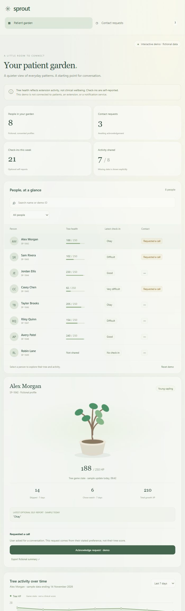

# Sprout

A local-first browser extension for mindful short-form video browsing, with an interactive clinician dashboard demo. Minimal frosted-glass UI, a growing SVG tree, and optional check-ins.

## Start here

### Browser extension

1. Clone or download this repository.
2. Open Chrome or Edge and visit chrome://extensions or edge://extensions.
3. Enable Developer mode, choose **Load unpacked**, and select the **extension/** directory (the directory containing manifest.json).
4. Open or refresh TikTok, Instagram Reels, or YouTube Shorts.
5. Open Sprout's toolbar popup and choose **Test prompt on current tab**.

No build, dependencies, API keys, or account required. After changing code, reload the extension and refresh the video tab.

### Clinician dashboard demo

Open **clinician-demo/index.html** in a browser. If you prefer a local server, run the following from the repository root with Python 3 installed:

    python -m http.server 8000 --directory clinician-demo

Then visit http://localhost:8000. All eight profiles, check-ins, requests and tree histories are fictional. Search, select a profile, change the chart range, acknowledge a request, export a fictional summary, or reset the demo. Session state stays in your browser.

## Project map

- **extension/** — Manifest V3 extension, currently v1.7.0.
- **extension/content/** — feed adapters, local classification, embedded metadata extraction, prompts, draggable tree widget.
- **extension/shared/** — serialized state helpers and SVG tree rendering.
- **extension/popup/** — dashboard/settings.
- **extension/clinician/** — optional local check-ins and user-held report export.
- **clinician-demo/** — independent clinician demo site; no live patient connection.
- **docs/** — teammate handoff and manual verification.

## What works locally

The extension scans available descriptions, hashtags, music labels, comments, captions and ID-matched embedded metadata. It pauses a flagged video and offers Yes/No. No attempts to skip and grants 5 HP + 3 XP; Yes resumes playback and costs 15 HP + 10 XP. HP is capped at 250. Tree stages require 150, 450, 900 and 1500 XP. The movable widget gives per-choice feedback. Optional care recording is off by default.

## Limits and privacy

Detection is heuristic and depends on platform markup and available text. It is not audio-mood recognition, speech transcription, OCR, or a clinical assessment. Live-feed compatibility needs browser testing. Tree HP/XP measure extension activity, not mental state or clinical risk. Missing data does not establish wellbeing.

The clinician demo is not connected to the extension. The extension's Care view records consented data locally and exports a user-reviewed report; it does not notify clinicians. A real clinic integration requires separate consent, verified identities, secure storage and delivery, and an agreed clinical workflow. See **extension/clinician/SYSTEM.md**.

No user browsing data, actual check-ins, patient reports, credentials, Sites deployment identity, or API tokens are included in this repository.

## Working together

Create a branch, make your changes, follow **docs/TESTING.md**, and open a pull request. See **docs/HANDOFF.md** for current status and next work. No open-source license has been selected; arrange permission before redistribution outside the team.
